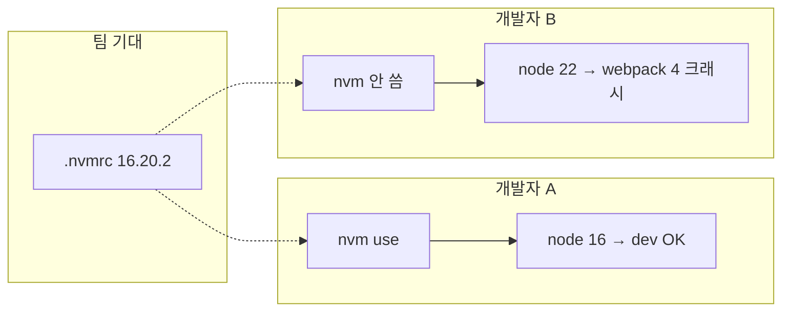

# .nvmrc와 실제 Node 버전이 다를 때

> 작성일: 2026-06-08
> 맥락: 레포에는 Node 16이 적혀 있는데 내 PC는 22다. 나만 dev 서버가 터지거나, 반대로 팀원만 터질 때

## 이 글의 질문

- `.nvmrc` 파일은 자동으로 Node를 바꿔 주나?
- 같은 브랜치인데 왜 A는 되고 B는 `ERR_OSSL_EVP_UNSUPPORTED`인가?
- 팀 기준 Node를 맞추는 가장 단순한 방법은?

## 핵심 (먼저 읽기)

| | `.nvmrc`만 있음 | `nvm use` / `fnm use` 실행 후 |
|--|----------------|------------------------------|
| **의미** | “이 프로젝트는 이 버전을 쓰자”는 **메모** | 실제 셸의 `node -v`가 바뀜 |
| **이 레포** | `carenation/.nvmrc` → `16.20.2` | 16이면 webpack 4 dev 보통 OK |
| **Node 22로 실행** | `.nvmrc`는 그대로인데 터미널만 최신 | COMMON(5300) OpenSSL 오류 가능 |

**이 레포에서 겪은 패턴:** `.nvmrc`는 16인데 `node -v`가 22.16.0 → `dev:all`의 COMMON이 죽고, INTEGRATED(3000)만 살아 프록시 ECONNREFUSED가 따라옴.

## 전제 (30초)

- **Node 버전**: 프로젝트마다 호환되는 범위가 다르다. 특히 **네이티브 모듈·OpenSSL·번들러**는 Node 메이저 버전에 민감하다.
- **`.nvmrc`**: nvm/fnm/asdf 같은 버전 관리 도구가 읽는 **한 줄짜리 버전 pin**. 파일만 커밋한다고 PC의 Node가 바뀌지는 **않는다**.
- **드리프트(drift)**: 문서(.nvmrc)와 실제 환경(`node -v`)이 어긋난 상태.

## 한눈에



## 용어 (이 글에서만)

| 용어 | 한 줄 뜻 |
|------|----------|
| `.nvmrc` | 프로젝트 루트에 두는 권장 Node 버전 파일 |
| nvm / fnm | Node 여러 버전을 설치·전환하는 CLI |
| 메이저 버전 | 16 → 17 → 22처럼 앞자리가 바뀌는 단위 (호환성 경계가 자주 여기서 갈림) |
| 드리프트 | pin과 실제 사용 버전 불일치 |

---

## 한 줄 요약

**.nvmrc는 “이 버전 써 달라”는 표지판이지, 자동 스위치가 아니다.** 터미널에서 맞춰 쓰지 않으면 로컬만 다른 Node로 돌아간다.

## 함정 한 가지

**착각:** “레포 clone했으니 팀이랑 같은 Node다.”  
**실제:** `node -v`는 **전역 설치·다른 프로젝트에서 쓰던 버전**이 그대로일 수 있다. 이슈 재현 전에 **항상 해당 폴더에서** `node -v`를 찍는다.

## 언제 문제가 보이나

| 상황 | 증상 |
|------|------|
| .nvmrc 16, 실제 22 + react-scripts 4 | dev start 즉시 OpenSSL 오류 |
| .nvmrc 16, 실제 16 | 대체로 정상 (다른 원인 가능) |
| CI는 16, 로컬 22 | “CI는 되는데 내 PC만 안 됨” / 반대도 가능 |
| README는 18 적고 .nvmrc는 16 | 문서끼리 충돌 — 더 최신 pin을 따를지 팀 합의 필요 |

## 왜 이렇게인가

Node는 **메이저 버전마다 내장 라이브러리(OpenSSL 등)** 가 바뀐다. 레포는 `package-lock.json`·`react-scripts` 버전으로 **특정 시점의 Node**를 가정하고 고정되는데, 개발자 PC의 Node는 OS 설치·다른 프로젝트 때문에 더 최신일 수 있다.

`.nvmrc`는 그 갭을 줄이려는 **단일 진실 공급원(SSOT)** 에 가깝다. 다만 도구가 `cd`할 때 자동 전환(`fnm default`, direnv 등)을 켜지 않으면 **수동 `nvm use`** 가 필요하다.

대안: (1) 프로젝트 들어갈 때 `nvm use` / `fnm use` 습관. (2) `engines` 필드를 package.json에 넣고 `engine-strict` — 잘못된 버전이면 install 단계에서 경고. (3) 근본적으로 webpack 5 등으로 올려 Node 22도 공식 지원 — 시간이 든다.

## 참고 코드

이 레포 carenation의 pin:

```1:1:carenation/.nvmrc
16.20.2
```

`dev:all`은 Node 버전을 검사하지 않고 바로 `react-app-rewired`를 호출한다. 그래서 **버전 드리프트가 그대로 빌드 체인에 전달**된다.

## 이 레포에서는

| 항목 | 내용 |
|------|------|
| pin 위치 | `carenation/.nvmrc` |
| 권장 버전 | 16.20.2 |
| 이번 세션 실제 | Node v22.16.0 (로그 기준) |
| 연쇄 증상 | webpack 4 실패 → 5300 미기동 → 프록시 ECONNREFUSED |
| 로컬 맞추기 | `cd carenation` 후 `nvm install 16.20.2` / `nvm use` (또는 fnm 동등 명령) |
| 임시 우회 | Node 22 유지 시 `NODE_OPTIONS=--openssl-legacy-provider` ([OpenSSL 노트](./2026-06-08_node-openssl-webpack.md)) |

### 확인 체크리스트 (clone 안 한 사람도 가능)

1. `cd carenation`
2. `node -v` 출력이 `.nvmrc`와 같은 메이저(16.x)인지
3. 다르면 `nvm use` 또는 fnm으로 16.20.2 전환
4. `npm run dev:all` — **[COMMON]** 이 compile 성공하는지 먼저 확인
5. 그다음 `http://localhost:3000/common/...` 접속

## 더 볼 것 (선택)

- [fnm 자동 전환](https://github.com/Schniz/fnm#shell-setup) — 디렉터리 이동 시 `.nvmrc` 적용
- [Volta](https://volta.sh/) — package.json에 Node pin
- 관련: [OpenSSL·webpack](./2026-06-08_node-openssl-webpack.md), [프록시·업스트림](./2026-06-08_proxy-econnrefused-upstream.md)
