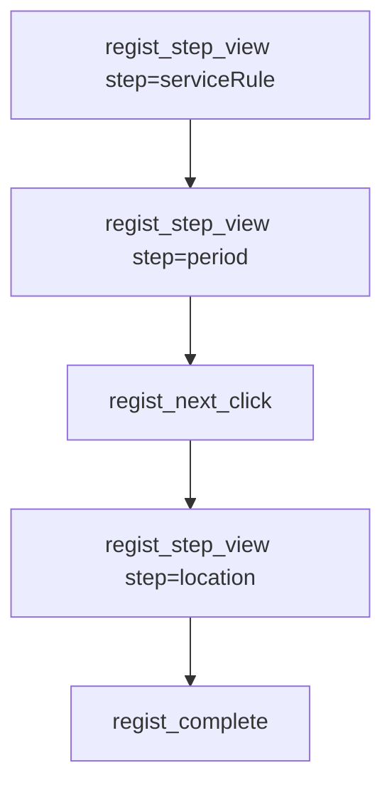

# 등록 퍼널·단계 시간 — URL만으로는 부족한 이유

> 작성일: 2026-06-09
> 맥락: “페이지 잔존율”, “다음 버튼 누르기까지 몇 초” 같은 지표로 간병 등록 플로우를 개선하고 싶은데, 지금 GA4 설정만으로는 숫자가 안 나올 때

## 이 글의 질문

- GA4 pageview만 있으면 등록 단계별 이탈률을 볼 수 있나?
- “클릭 후 다음 액션까지 N초”는 어떻게 재나?
- 어떤 이벤트 이름을 어디에 심어야 하나?

## 핵심 (먼저 읽기)

| 측정하고 싶은 것 | pathname pageview만 | 커스텀 이벤트 추가 후 |
|------------------|---------------------|------------------------|
| `/care/...` 방문 수 | ✅ | ✅ |
| 등록 **단계별** 진입·이탈 | △ URL이 단계마다 다를 때만 | ✅ `regist_step_view` |
| **다음** 버튼까지 걸린 시간 | ❌ | ✅ 이벤트 타임스탬프 차이 |
| 병원 vs 가정 등 **맥락** | ❌ (query 미포함) | ✅ 파라미터로 전송 |

**권장:** 간병 등록(`registRenewal`)은 단계마다 **의도된 이벤트**를 심고, GA4 퍼널·Looker에서 본다.

## 전제 (30초)

- **퍼널**: 사용자가 거치는 단계 줄(시작 → … → 완료). 중간에 끊기면 **이탈**.
- **커스텀 이벤트**: 개발자가 “이 순간을 기록해”라고 GA4에 보내는 신호. pageview와 별개.
- **이벤트 파라미터**: 이벤트에 붙는 라벨 (`step: period`, `location_type: hospital`).

## 한눈에



GA4는 각 이벤트의 **발생 시각**을 저장한다. 같은 사용자의 `step=period` 시각과 다음 `regist_next_click` 시각 차이 → **체류·지연** 추정.

## 용어 (이 글에서만)

| 용어 | 한 줄 뜻 |
|------|----------|
| pageview | URL 경로 기준 방문 1건 |
| 커스텀 이벤트 | `regist_step_view`처럼 이름 붙인 행동 기록 |
| 퍼널 탐색 | GA4에서 단계별 통과·이탈을 보는 화면 |
| 이탈 | 다음 단계 이벤트 없이 끝난 경우 |

---

## 한 줄 요약

**경영·기획이 원하는 “단계별 잔존·소요 시간”은 URL 자동 기록만으로는 부족하고, 단계·클릭·완료를 이름 붙여 GA4에 보내야 한다.**

## 함정 한 가지

**“라우트가 7개니까 pageview 7번이면 퍼널이다”** → 사용자가 **뒤로가기·중간 이탈·같은 URL 재진입**을 하면 pageview만으로는 **의도한 단계와 1:1이 안 맞는다**. 비즈니스 단계 = **이벤트로 명시**하는 편이 안전하다.

## 왜 이렇게인가

care의 `GA4Tracker`는 `location.pathname`만 보낸다. query string(`?jobId=`)은 빠진다. 등록 리뉴얼은 라우트는 나뉘어 있어도(**serviceRule → period → location → …**), 경영이 보고 싶은 건 **기획 단계 이름**과 **버튼 클릭 간격**이다. 그건 URL 문자열과 다를 수 있다.

예전 care 등록(`write.tsx`)에는 단계마다 `P-MCCRN` 같은 **page_code**를 소켓으로내려 했으나 지금은 **주석 처리**되어 있다. 백엔드 조회 API도 없으므로, 같은 목적은 **GA4 커스텀 이벤트**로 대체하는 게 현실적이다.

네이티브 `analyticsEvent('care_reg_cp')`는 **완료 한 번**만 잡는다. 중간 단계 이탈은 못 본다.

## 설계 예시 (간병 등록 registRenewal)

| 시점 | 이벤트명 | 파라미터 예 |
|------|----------|-------------|
| 단계 화면 마운트 | `regist_step_view` | `step`: serviceRule, period, location, patient, details, certificate |
| 다음/이전 | `regist_next_click` / `regist_back_click` | `step`, `location_type` |
| 등록 완료 | `regist_complete` | (기존 `care_reg_cp`와 맞추면 좋음) |
| (선택) 이탈 | `regist_abandon` | `last_step` |

구현 패턴: 공통 헬퍼 하나 + 각 단계 컴포넌트 `useEffect`에서 `step_view`, 버튼 handler에서 `next_click`.

## 참고 코드

일반적으로 React GA4:

```javascript
ReactGA.event('regist_step_view', { step: 'period' });
```

이 레포에서 pageview만 있는 부분:

```10:14:care/src/app/hooks/GA4Tracker.ts
    ReactGA.send({ hitType: 'pageview', page: location.pathname });
```

등록 라우트 예 (이벤트는 아직 없음):

- `/care/newRegist/serviceRule`
- `/care/newRegist/period`
- `/care/newRegist/location`
- … (`care/src/app/index.tsx` Routes)

## 이 레포에서는

| 현재 | 부족한 것 |
|------|-----------|
| pathname pageview | 단계별 `regist_step_view` |
| `care_req_g` / `care_reg_cp` 등 소수 네이티브 이벤트 | 중간 단계·클릭 간격 |
| 소켓 `viewPage` (주석) | 운영 대시보드 연동 없음 |

**다음 작업(구현 시):** `registRenewal` 각 페이지 + 공통 progress 컴포넌트에 이벤트 심기 → REAL 1~2주 수집 → GA4 퍼널 검증 → Looker 연결.

## 더 볼 것 (선택)

- [Looker에서 경영 대시보드](./2026-06-09_looker-ga4-exec-dashboard.md)
- [GA4 vs Clarity](./2026-06-09_ga4-vs-clarity-roles.md)
