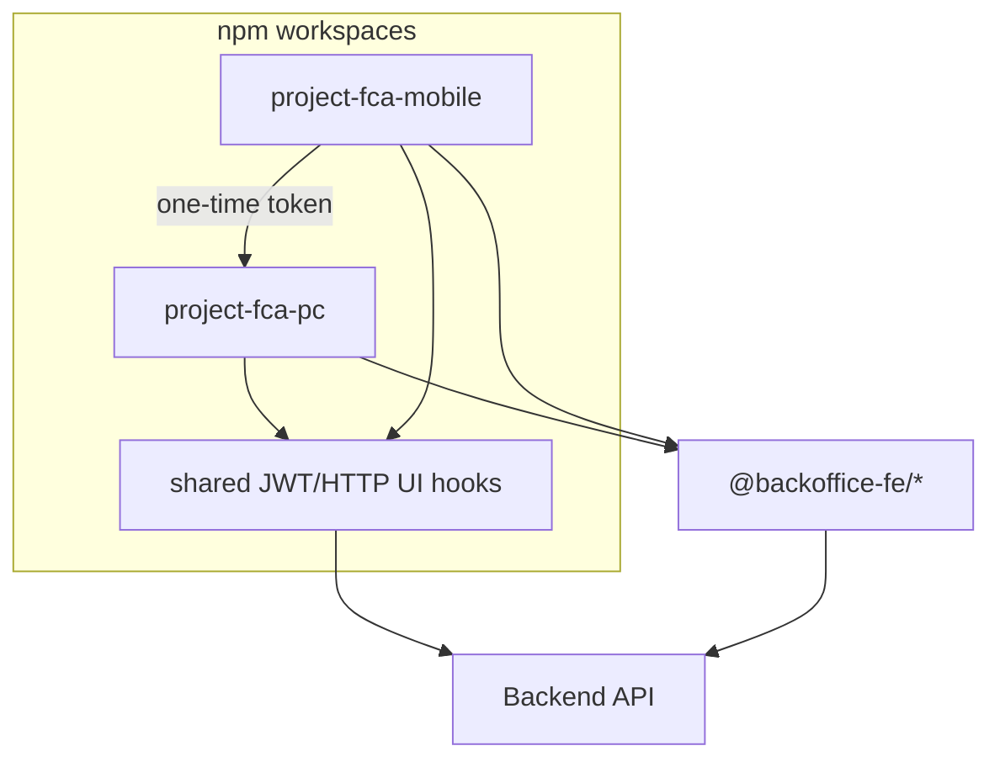
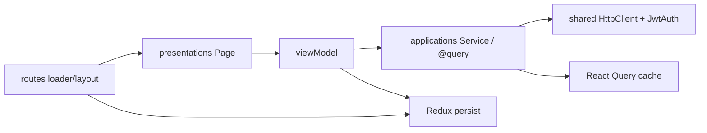

# 손해보상찾기

## 한 줄 요약
손해보상찾기 PC/모바일 npm 워크스페이스 백오피스 프론트엔드로, MVVM형 계층·서버/클라이언트 상태 분리·라우트 다층 인가를 뼈대로 상담·계약·결제·계정 도메인과 디바이스 간 세션 이어가기를 구성함.

## 기술 스택 / 역할 키워드
- React 18, TypeScript, Vite (dev/qa/prod/proto 모드 빌드)
- React Router v6 (createBrowserRouter, loader, @loadable/component)
- Redux Toolkit + redux-persist (version migration)
- TanStack React Query (QueryClient / QueryCache 전역 에러 처리)
- axios 기반 HTTP·JWT (`@hmc-fca-fe/shared`, `@backoffice-fe/service`)
- MUI / Ant Design / Sass, Chart.js, html2canvas·jsPDF
- Vitest·Testing Library, Microsoft Clarity(프로덕션)
- 워크스페이스: project-fca-pc · project-fca-mobile · shared
- 역할 키워드: 프론트엔드 아키텍처, 모노레포, MVVM형 계층, 관심사 분리, 인가 레이어, 서버/클라이언트 상태 분리, 라우트 데이터 로딩

---

## 아키텍처

### 한 줄 (아키텍처)
앱(배포 단위)은 PC/모바일로 쪼개고, 도메인 코드는 applications → presentations(viewModel) → UI로 흐르게 두며, 인증·영속 상태는 Redux, 서버 캐시는 React Query, 진입 전 준비는 Router loader가 담당하는 다층 구조.

### 패키지 경계 (모노레포)
```
hmc-fca-fe (npm workspaces)
├── project-fca-pc      # PC 백오피스 앱 (Vite 빌드/배포 단위)
├── project-fca-mobile  # 모바일 앱 (Vite 빌드/배포 단위)
└── shared             # @hmc-fca-fe/shared — HTTP/JWT, DTO, 공통 UI·훅·검증
(+ 사내 @backoffice-fe/hook|service|type|component — 모노레포 밖 의존)
```
- **의존 방향(코드상):** pc/mobile → shared · @backoffice-fe/* . shared가 앱을 참조하지 않는 형태로 공통을 제공.
- **쪼갠 이유:** UX·메뉴 범위(PC 전용 계정/티켓 등)가 다르고 배포 브랜치/환경이 갈라짐(Readme). 공통만 shared로 모아 중복을 줄임.
- **한계:** PC와 모바일 폴더 관례가 완전히 동일하지 않음(PC `applications` vs 모바일 `application` 등). 사내 패키지와 로컬 shared가 병존해 “공통의 단일 출처”는 아님.

### 앱 내부 계층 (MVVM형)
`NamingConvention.md`·README 기준 레이어와 책임:

| 레이어 | 역할 | 예 |
|--------|------|-----|
| routes | URL·레이아웃·loader·인가 진입점 | Router, authProtectedLoader |
| presentations | Page/UI + viewModel 훅 | ConsultDetailPage, useLogin |
| applications | API Service, request/response DTO, React Query 옵션 | ConsultService, @query |
| core | 상수·enum·모델·순수 유틸 | Routes, enum, fileUtils |
| store | 전역·영속 클라이언트 상태 | auth/user/modal slices + persist |

데이터/이벤트 흐름(의도된 방향):
```
UI(Page) → viewModel → applications(@query|Service) → HttpClient/JWT(shared)
                ↓
         store(역할·토큰 등 영속) ←→ Router 가드/loader
```
- **왜:** API·캐시·화면 상태를 한 파일에 섞지 않아 도메인 추가 시 위치·네이밍이 고정됨.
- **viewModel:** 화면 전용 상태·검증·네비게이션을 훅으로 모아 Page를 얇게 유지(프레젠테이션과 유스케이스 경계).

### 상태 소유권 (아키텍처 핵심)
| 상태 종류 | 소유 | 근거 |
|-----------|------|------|
| 서버 데이터(목록/상세) | TanStack Query | @query, QueryClientProvider |
| 토큰·유저·역할 등 영속 | Redux + redux-persist | store whitelist, migration |
| 모달·주소·포인트 등 UI/세션성 전역 | Redux (일부 non-persist) | modal 등 ignoredPaths |
| 라우트 진입 전 필수 데이터·인증 확인 | React Router loader | mobile loaders |

- **트레이드오프:** 유저/역할은 persist와 API 응답이 맞닿아 동기화 규칙이 필요. persist `version`+migration이 스키마 진화 대응.
- **Query 전역 에러:** QueryCache.onError에서 Forbidden/승인대기 커스텀 에러를 분기 — “데이터 계층의 인가 부작용”을 UI 가드와 분리.

### 인가·인증 레이어 (다층)
```
[1] JwtAuth 등록 (App 부트) — storage + AuthAPI
[2] Router loader — 미인증 시 리다이렉트 (mobile authProtectedLoader)
[3] Layout 가드 — path×역할 정책 (RoleRestricted*)
[4] Query/API 에러 — Forbidden / ApprovedPendingAccessError
```
- **이유:** 진입 전(loader/layout)과 진입 후·서버 거부(Query)를 한 레이어에 몰지 않음. PENDING_CEO 등 상태 전이는 레이아웃에서 명시 분기.

### 앱 컴포지션 (Provider 스택)
코드상 공통 골격:
```
Redux Provider → PersistGate → (Clarity) → QueryClientProvider → RouterProvider
(+ PC: OverlayProvider / Mobile: CollapsableHeaderProvider)
```
- HTTP baseURL·JwtAuth.register는 렌더 전 모듈 스코프에서 설정 — 인프라 부트스트랩과 UI 트리를 분리.

### 라우팅·코드 스플리팅
- `createBrowserRouter` + future v7 플래그.
- 모바일: `@loadable/component`로 페이지 단위 지연 로딩, 상세/채팅/계약 미리보기 등 loader 병행.
- PC: (현재) 전 경로 `ServiceClosedPage` — 기능 아키텍처는 주석 라우트·도메인 코드에 보존.

### PC ↔ 모바일 연동 (크로스 앱)
- 배포 단위가 둘이라 스토리지/오리진이 갈라짐 → 원타임 토큰 쿼리로 상대 앱에서 세션 재구성(`UATransition`).
- 기능 경계: 모바일에서 PC 전용 경로 목록으로 차단 후 PC 유도 — **제품 경계를 라우트 정책으로 표현**.

### 아키텍처 다이어그램 (요약)




---

## 이력서 불릿

### 모노레포
- PC·모바일·shared를 npm workspaces로 묶어 배포 단위와 공통 라이브러리 경계를 분리함.
- shared에 JwtAuth·HttpClient·에러 DTO·공통 UI/훅을 두고, 사내 `@backoffice-fe/*`와 병행해 인프라·타입을 재사용함.

### 아키텍처 (계층·상태·인가)
- applications / presentations(viewModel) / store / routes / core로 관심사를 나눠 도메인 추가 시 파일 위치·네이밍 기준을 고정함.
- 서버 상태(Query)·영속 클라이언트 상태(Redux persist)·진입 전 준비(loader)로 상태 소유권을 분리함.
- 인증 부트스트랩 → loader → 역할 레이아웃 가드 → Query 에러 분기의 다층 인가를 구성함.
- persist version·migration으로 role 등 스토어 스키마 변경에 대응함.

### 1. 역할·승인 인가
- PC path별 역할 정책 맵, 모바일 RoleRestricted·authProtectedLoader, QueryCache Forbidden/승인대기 분기.

### 2. PC ↔ 모바일 세션 이어가기
- 원타임 토큰+role 쿼리로 크로스 앱 세션 재구성, PC 전용 메뉴는 모바일에서 라우트 정책으로 차단.
- 모바일 `--vh`(visualViewport) 보정.

### 3. 계층 + Query / Redux (기능 관점 요약)
- 위 「아키텍처」 절과 동일 축 — 도메인 Service·Page·loader로 상담/계약/결제 등을 확장.

### 4. 대시보드 차트 · 계약 PDF
- Chart.js 대시보드 섹션 + DashboardService, iframe+html2canvas+jsPDF 계약 PDF(`useDownloadPdf`).

### 도메인 범위 (참고)
- PC: 인증·회원·계정·상담·계약·티켓·결제·대시보드. (현재 라우트 ServiceClosed, 기존 라우트 주석 보존)
- 모바일: 상담·채팅·신청자·계약 발송/미리보기·결제 등 loadable 라우트.

## STAR

### 1. 역할·승인 상태에 따른 라우트 인가
- S: 다역할·승인 대기 상태가 혼재.
- T: 권한 없는 접근 차단, 승인 상태 전이를 UI·API 양쪽에서 일관 처리.
- A: path 정책 맵 + loader 가드 + QueryCache 커스텀 에러 분기(다층 인가).
- R: 코드로 확인된 정량 성과 없음.

### 2. PC/모바일 분리와 세션 이어가기
- S: 배포·메뉴 범위가 다른 두 앱.
- T: UX 분리 유지 + 로그인 연속성.
- A: workspaces 분리, PC 전용 경로 정책, 원타임 토큰 UA 전환.
- R: 코드로 확인된 정량 성과 없음.

### 3. MVVM형 계층·상태 소유권 설계
- S: 도메인·화면이 늘고 PC/모바일이 API·인증을 공유.
- T: 파일 경계·서버/클라이언트 상태 책임을 팀 단위로 고정.
- A: applications/presentations/store/routes 계층, Query vs Redux persist vs loader 역할 분리, NamingConvention 문서화.
- R: 코드로 확인된 정량 성과 없음.

### 4. 계약 PDF · 대시보드 시각화 (PC)
- S: 계약 다운로드·운영 현황 시각화 필요.
- T: 브라우저 PDF·차트 UI 제공.
- A: useDownloadPdf, dash Chart.js + DashboardService.
- R: 코드로 확인된 정량 성과 없음.

### 5. npm workspaces 모노레포
- S: 공통 인증/HTTP/UI와 분리 배포가 동시에 필요.
- T: 앱 독립 빌드 + 공통 재사용.
- A: pc/mobile/shared workspaces, shared 인프라·UI, 앱별 Vite mode.
- R: 코드로 확인된 정량 성과 없음.

## 면접 Q&A

### Q. 이 프론트의 아키텍처를 한 장으로 설명하면?
A. 배포는 PC/모바일/shared 모노레포, 앱 안은 routes(진입·인가) – presentations/viewModel(화면 유스케이스) – applications(API·Query) – store(영속 클라 상태) – shared(HTTP/JWT). 서버 데이터는 Query, 세션성 신원은 Redux persist, 진입 전 준비는 loader.

### Q. 왜 모노레포(workspaces)인가?
A. UX·메뉴·배포 단위는 갈라지고 JWT/HTTP·DTO·일부 UI는 공유한다. 앱과 shared 경계를 패키지로 고정. `@backoffice-fe/*`는 사내 공통으로 병행.

### Q. MVVM이라고 해도 되는가? 정확한 표현은?
A. README에 MVVM(안)으로 적혀 있고, viewModel 훅 + Page + Service 분리가 그 취지다. 엄밀한 데스크톱 MVVM보다는 **계층형 FE + viewModel 훅**에 가깝다고 말하는 편이 코드와 맞다.

### Q. 상태 관리를 Query와 Redux로 나눈 트레이드오프는?
A. 캐시 무효화·재fetch는 Query, 새로고침 후에도 남을 신원·역할은 persist. 맞닿는 데이터는 동기화·migration 비용이 생긴다.

### Q. 인가를 왜 한곳이 아니라 여러 레이어인가?
A. loader/layout은 네비게이션 시점, Query 에러는 API가 거부한 시점. 역할 변경·승인 전환은 서버가 최종이므로 UI만으로 닫을 수 없다.

### Q. shared와 @backoffice-fe 의존을 아키텍처적으로 어떻게 보나?
A. 로컬 shared = 이 제품군 공통, @backoffice-fe = 조직 공통. 중복 위험이 있어 경계를 면접에서 솔직히 구분한다. 후자 전체를 본인 설계로 말하지 않는다.

### Q. loader vs viewModel useEffect fetch — 언제 loader인가?
A. 라우트 전환 전 데이터가 없으면 화면이 성립하지 않을 때(상세·미리보기·인증 확인). 상호작용 후 갱신은 viewModel+Query가 맞다.

### Q. PC ServiceClosed는 아키텍처를 어떻게 설명해야 하나?
A. 현재 런타임 진입점은 종료 페이지이나, 도메인 계층·주석 라우트에 설계가 남아 있다. “운영 중”이 아니라 “구축·전환한 구조”로 말한다.

### Q. PDF를 클라에서 만드는 아키텍처적 함의는?
A. 문서 렌더링을 FE에 두어 서버 PDF 파이프라인 없이 빠른 전달이 가능. 대신 성능·인쇄 정확도·보안은 서버 생성 대비 약점 — 트레이드오프로 설명.

### Q. 의존성 방향에서 깨지기 쉬운 지점은?
A. presentations가 Service URL을 직접 알거나, store에 서버 목록 전체를 넣거나, shared가 앱 스토어를 import하면 계층이 붕괴한다. 현재 컨벤션은 Service/@query와 viewModel을 매개로 두도록 문서로 고정.

## 근거
- package.json (루트 workspaces)
- Readme.md, NamingConvention.md
- project-fca-pc: App.tsx, routes/Router.tsx, store/index.ts, RoleRestrictedLayout.tsx, applications/@query, useDownloadPdf.ts, presentations/dash/*
- project-fca-mobile: App.tsx, routes/Router.tsx, RoleRestricted.tsx, UATransition.tsx, loaders/*
- shared/package.json, shared/src/application/service/*
